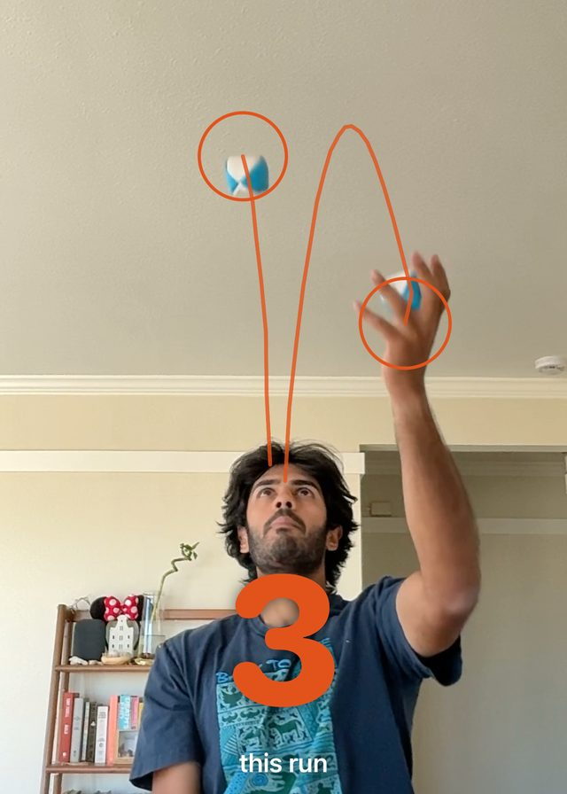

# Juggle Tracker

<p align="center"></p>

Counts juggling throws from a camera. A small YOLO11n detector finds the balls in each frame. A
tracker follows each ball and counts one throw at the top of every arc. A run ends when the throws
stop.

The repo has four parts:

| Folder | What it is |
|---|---|
| [`data_labelling/`](data_labelling/README.md) | Turns juggling videos into training data. It auto-labels balls, and a browser tool lets you fix ball boxes and tap throws by hand. |
| [`model/`](model/README.md) | Trains, evaluates and releases the ball detector. Also holds the reference throw counter (`web/counter.js`) and a browser demo. |
| [`ios/`](ios/README.md) | **Juggle Tracker**, the native iPhone/iPad app. It counts on-device with Core ML and keeps your session history. |
| [`claude_plugin/`](claude_plugin/README.md) | **juggle-break**, a Claude Code desktop plugin. A camera pane counts your juggles while Claude works. |

```
videos ──► data_labelling ──► data_labelling/data/ds ──► model (train) ──► GitHub release model-<version>
                                                                                │
                              ios app (Core ML) ◄── model/current ◄─────────────┘
                              claude_plugin (ONNX) ◄──┘    (model/fetch.sh)
```

## Models

Each trained model is published as a GitHub release (`model-r3`, …) with `ball.onnx`,
`BallModel.mlpackage.zip` and `ball.pt` attached. `model/fetch.sh` downloads the release that
`model/current` points to into `model/releases/<version>/`. That is the only copy on disk.
Everything else links to it:

- `ios/JuggleTracker/JuggleTracker/Model/BallModel.mlpackage` → `model/current/BallModel.mlpackage`
- `claude_plugin/model/ball.onnx` → `model/current/ball.onnx`
- `model/web/model/ball.onnx` → `model/current/ball.onnx`

To ship a new model, run `model/release.sh <version> <weights.pt>` and commit the updated
`model/current` link. See [`model/README.md`](model/README.md).

## Quick start

```bash
git clone <this repo> && cd juggle_tracker
model/fetch.sh            # download the current model release (needed by every part)
```

Then follow the README of the part you want.

- **iOS app**: open `ios/JuggleTracker/JuggleTracker.xcodeproj` and run.
- **Claude plugin**: `claude_plugin/setup.sh`, then load the folder as a plugin.
- **Retrain**: set up the Python environment in `model/README.md`, then work through
  `data_labelling/` and `model/`.

The training videos, extracted frames and auto labels are not in the repo. The hand-made labels
are: ball boxes in `labels_manual/` and throw taps in `throws.labels.json`.

## License

[AGPL-3.0](LICENSE). The detector is trained and exported with [Ultralytics](https://github.com/ultralytics/ultralytics), which is AGPL-3.0.
